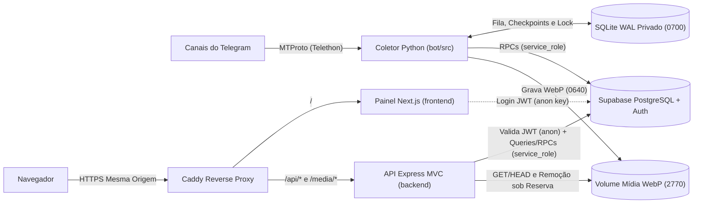
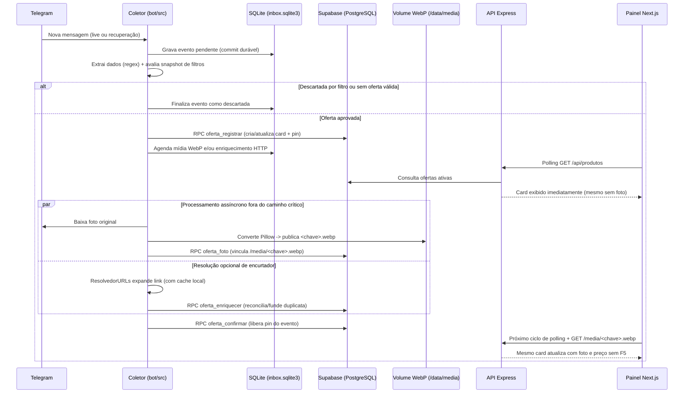

# Dealbot

O **Dealbot** monitora canais de promoções no Telegram, filtra mensagens na chegada com regras determinísticas e reúne as ofertas relevantes em um painel web autenticado. Em vez de acompanhar dezenas de canais manualmente, você consulta ofertas categorizadas, acompanha quedas de preço, acessa o link direto da loja e copia cupons em um único lugar.

[Funcionalidades](#funcionalidades) · [Stack Tecnológica](#stack-tecnológica) · [Arquitetura](#arquitetura) · [Início Rápido](#início-rápido) · [API REST](#api-rest-e-rotas) · [Modelo de Dados](#modelo-de-dados) · [Testes](#testes-e-qualidade) · [Documentação](#documentação)

---

## Funcionalidades

### Coleta resiliente e fila durável (`bot/src/`)
- **Tempo real + recuperação paginada:** escuta novas mensagens via `Telethon` (`NewMessage`) e reconcilia lacunas pelo histórico dos canais ativos (`BOT_BOOTSTRAP_HORAS=24` na primeira execução e cursores por `canal_id` nas seguintes).
- **Controle de *backpressure*:** fila limitada na recepção (`FilaUpdatesLimitada`). Em caso de sobrecarga, desconecta de forma limpa sem avançar o cursor e retoma a cobertura pelo histórico.
- **Estado persistente isolado:** inbox em **SQLite WAL** (`synchronous=FULL`) com cota de prioridade para mensagens *live* sobre histórico e trava exclusiva de arquivo (`coletor.lock`) que impede duas instâncias no mesmo diretório de estado.

### Extração contextual determinística (sem IA)
- **Zero dependência de LLMs ou chamadas externas na extração:** heurísticas e expressões regulares em [`bot/src/extractor.py`](bot/src/extractor.py) processam uma oferta por mensagem localmente.
- **Precisão monetária em centavos:** identifica preço à vista/PIX e preço original (para cálculo de `% OFF`), separando valores de parcelas, frete, cashback e compra mínima.
- **Metadados comerciais:** extrai título limpo, cupom (explícito ou código monoespaçado isolado), prioriza links de compra sobre redes sociais e classifica automaticamente em 7 categorias (`eletronicos`, `games`, `casa`, `moda`, `alimentos`, `beleza` e `outros`).

### Motor de filtros previsível em duas camadas
- **Bloqueios globais (`bloqueio_global`):** avaliados primeiro sobre a descrição completa da oferta (modo `qualquer` ou `todas`). Nenhum interesse sobrepõe um veto global.
- **Regras de interesse (`interesse`):** avaliadas em **OU** entre regras ativas e **E** entre condições da mesma regra (palavras-chave em `qualquer`/`todas`, categoria, teto `preco_max` comparado em centavos e palavras de bloqueio locais). Sem regras de interesse ativas, ofertas válidas não vetadas globalmente são aceitas.
- **Snapshots validados:** o coletor atualiza os filtros em memória periodicamente (`15s` por padrão) e mantém o último snapshot íntegro caso ocorra falha transitória de rede.

### Identidade v2, enriquecimento assíncrono e deduplicação conservadora
- **Vínculo numérico imutável:** eventos são rastreados pelo par `(canal_id, telegram_msg_id)`, evitando colisões por troca ou reutilização de `@username`.
- **Identidade estruturada e assinatura de cópia:** reconhece formatos canônicos iniciais — Amazon BR (`/dp/ASIN`, ignorando `tag` de afiliado quando os demais atributos obrigatórios estão comprovados) e Mercado Livre (`/MLB-...`) — além de assinatura de cópia (`copia` v1: destino + conteúdo normalizado + preço em centavos) para republicações equivalentes entre canais.
- **Resolução de encurtadores fora do caminho crítico:** workers dedicados (`ResolvedorURLs`) expandem URLs com cache positivo (`24h`) e negativo (`15min`) no SQLite e reconciliam cards provisórios via RPC `oferta_enriquecer`, fundindo duplicatas no card canônico de menor ID (`canonico_id`).
- **Histórico comercial:** mantém janela deslizante de validade (`48h` por padrão), consolida os canais onde a promoção apareceu (`@canal +N`) e sinaliza quedas ou alterações de preço (`preco_anterior_atualizacao`).

### Mídia WebP em segundo plano e protocolo *tombstone*
- **Oferta antes da foto:** o card e o link de compra entram imediatamente no painel; o download e a conversão da imagem ocorrem em paralelo sem bloquear a fila de ofertas.
- **Publicação local enxuta:** em `BOT_MIDIA_MODO=local`, o coletor valida bytes e dimensões (`<= 10 MiB`, `<= 24 MP`), redimensiona (`<= 960px`) e converte para **WebP** (`<= 350 KiB`) via `Pillow` em executor isolado, gravando arquivos finais imutáveis (`<32-hex>.webp`) no volume compartilhado com a API (`/media/*`). Mídias antigas no Supabase Storage permanecem compatíveis.
- **Remoção coordenada sem corrida:** exclusões manuais ou por expiração reservam a URL em `oferta_midias` (*tombstone*) antes de apagar o arquivo físico, impedindo que um worker atrasado revincule uma foto já descartada.

### Painel web autoatualizável (`frontend/`)
- **Polling inteligente (`ControladorPolling`):** atualiza ofertas (`5s`) e métricas globais (`30s`) somente quando a aba está visível, aplica *backoff* exponencial em falhas, compartilha espera em `429 Retry-After` e cancela requisições obsoletas (`AbortController`).
- **Estabilidade visual e de sessão:** preserva a posição de rolagem (*scroll anchoring*) quando novos cards ou fotos chegam sem recarregar a página, copia cupons via Clipboard API e mantém a sessão durante falhas temporárias (`503`/rede) do provedor de autenticação.
- **Gestão integrada:** busca textual com *debounce*, filtragem rápida por categoria e interface completa em `/filtros` para criar, editar, pausar e excluir regras de captura.

---

## Stack Tecnológica

| Camada | Tecnologias e Versões | Papel no Sistema |
| --- | --- | --- |
| **Coletor (`bot/`)** | Python 3.12 (`3.12.16`), Telethon `1.36.0`, Pillow `13.0.0`, `supabase` `2.9.1`, SQLite 3 (WAL) | Captura MTProto no Telegram, fila durável local, extração por regex, filtros, resolução de URLs e geração de WebP. |
| **API (`backend/`)** | Node.js 24 LTS (`>=24 <25`), Express `4.19`, Zod `4.6.7`, Helmet `8`, `express-rate-limit` `7`, `@supabase/supabase-js` `2.45` | API REST em camadas MVC (`/api/*`), entrega somente leitura de WebP (`/media/*`), validação de JWT e limpeza agendada. |
| **Painel (`frontend/`)** | Next.js `16.4.6` (App Router), React `19.3.1`, TypeScript `5`, `@supabase/supabase-js` `2.45` | Interface autenticada com listagem autoatualizável de ofertas, métricas, cópia de cupons e CRUD de filtros. |
| **Dados e Auth (`supabase/`)** | PostgreSQL (Supabase), Supabase Auth, Row Level Security (RLS), PL/pgSQL RPCs | Persistência compartilhada de ofertas/regras/canais, autenticação de usuários e coordenação transacional por *advisory lock*. |
| **Infra e Proxy (`deploy/`)** | Docker Compose `v2.30+`, Caddy `2.11.9` | Orquestração local (demonstração sintética e uso real) e de VPS, TLS sob mesma origem e isolamento de volumes/permissões. |

---

## Arquitetura

### Topologia de Componentes



### Ciclo de Vida de uma Oferta



### Fronteiras de Armazenamento e Segurança

- **Supabase vs. Disco Local:** o Supabase permanece como fonte compartilhada para ofertas, aparições, regras de filtro, canais e autenticação. No Docker Compose, `bot` e `api` **nunca compartilham o banco SQLite**; compartilham apenas o volume dedicado de mídia WebP (`/data/media`), onde o coletor (`UID 10001`, dono da raiz `2770`) publica arquivos finais `0640` e a API (`UID 10002`, grupo `10000`) apenas lê ou remove chaves já reservadas no banco.
- **Modelo de duas chaves Supabase:**
  - **`anon` (pública):** usada pelo `frontend` para login no Supabase Auth e pelo cliente `supabaseAuth` da API exclusivamente para validar o JWT (`Authorization: Bearer <token>`) no middleware `autenticar`.
  - **`service_role` (secreta):** restrita ao servidor (`bot` e models do `backend` via `supabaseAdmin`). Nunca é exposta ao navegador nem incluída em variáveis `NEXT_PUBLIC_*`.
- **Camadas MVC no Backend:** fluxo unidirecional estrito `routes/ → controllers/ → services/ (validação Zod) → models/ (acesso exclusivo ao Supabase)`.
- **Containers endurecidos:** serviços rodam sem root, com `read_only: true`, `cap_drop: [ALL]`, `no-new-privileges: true` e `tmpfs` restrito.

---

## Estrutura do Repositório

```text
dealbot/
├── bot/                        # Coletor Python 3.12 (Telethon + SQLite + Pillow)
│   ├── src/                    # Implementação ativa (main.py, extractor, filters, identidade, midia, estado...)
│   ├── tests/                  # Suíte unittest (extrator, filtros, identidade, mídia, checkpoints, retomada)
│   ├── gerar_sessao.py         # Utilitário interativo para gerar TG_SESSION_STRING uma única vez
│   ├── simulacao.py            # Benchmark e simulação offline determinística
│   └── bot.py                  # Código legado inativo (antigo protótipo com IA/polling — não utilizado)
├── backend/                    # API REST em Node.js 24 + Express (ES Modules)
│   ├── src/
│   │   ├── config/             # Validação de env e clientes Supabase (Admin vs Auth)
│   │   ├── middlewares/        # Autenticação Bearer JWT e tratamento centralizado de erros
│   │   ├── routes/             # Rotas /api/* (autenticadas) e /media/:chave.webp (leitura pública)
│   │   ├── controllers/        # Orquestração HTTP
│   │   ├── services/           # Regras de negócio, schemas Zod e agendador de limpeza
│   │   ├── models/             # Queries PostgREST, chamadas RPC e leitura/remoção segura de WebP
│   │   └── preflight.js        # CLI operacional de pré-checagem de schema, mídia e Auth
│   └── tests/                  # Testes nativos (node --test) e runners SQL locais
├── frontend/                   # Painel Web em Next.js 16 (App Router) + React 19 + TypeScript
│   ├── app/                    # Páginas (/ listagem com polling, /filtros CRUD, /login)
│   ├── components/             # ProdutoCard, FiltroCategorias, BuscaInput, Header
│   ├── hooks/                  # useAuth (sessão Supabase resiliente a falhas transitórias)
│   ├── lib/                    # Cliente HTTP autenticado, ControladorPolling, tipos e helpers
│   └── tests/                  # Testes de UI, polling, autenticação e contratos de API
├── supabase/
│   └── schema.sql              # Tabelas, constraints, índices parciais, RLS, bucket legado e RPCs PL/pgSQL
├── deploy/                     # Orquestração Docker, Caddy e operação
│   ├── compose.base.yaml       # Definição base endurecida dos serviços (api, bot, painel)
│   ├── compose.local.yaml      # Modo B: execução local real (loopback :28443 + perfil coleta)
│   ├── compose.yaml            # Topologia de produção em VPS com rede externa do Caddy
│   ├── caddy/                  # Caddyfile local (TLS interno) e exemplo para VPS
│   ├── env/                    # Templates *.env.example separados por nível de privilégio
│   ├── scripts/                # Inicialização segura de volumes, preflight de host e backup SQLite
│   ├── lab/                    # Modo A: laboratório completo sem credenciais (:18443 + mock Supabase)
│   └── tests/                  # Testes do utilitário de backup/restauração do SQLite
└── docs/                       # Guias operacionais e histórico de especificações (SDD)
```

> [!NOTE]
> O diretório `bot/` contém dois pontos de entrada históricos: **sempre utilize `bot/src/` (`python -m src.main`)**, que é o coletor ativo usado pelos Dockerfiles e pelo `dealbot.service`. O arquivo solto `bot/bot.py` é legado inativo e permanece apenas como referência histórica.

---

## Início Rápido

### Modo A — Demonstração local sem credenciais (recomendado para conhecer o projeto)

O laboratório sobe painel, API, coletor sintético, proxy HTTPS Caddy e um mock local do Supabase. **Não exige conta no Supabase, chaves de API, arquivos `.env` nem sessão do Telegram**, e não exige Node.js ou Python instalados no host.

**Pré-requisitos:**
- Docker Engine (Linux) ou Docker Desktop com containers Linux / WSL 2 (Windows)
- Docker Compose `v2.30` ou superior

**1. Valide e suba os containers na raiz do repositório:**

```sh
docker compose -p dealbot-etapa5-lab -f deploy/lab/compose.yaml config --quiet
docker compose -p dealbot-etapa5-lab -f deploy/lab/compose.yaml up -d --build
```

**2. Confie na CA local de desenvolvimento (para habilitar HTTPS e cópia de cupom):**

```sh
docker compose -p dealbot-etapa5-lab -f deploy/lab/compose.yaml cp caddy:/data/caddy/pki/authorities/local/root.crt ./dealbot-lab-ca.crt
```

Importe `dealbot-lab-ca.crt` no seu navegador de testes ou no repositório de autoridades raiz do seu usuário (veja detalhes em [Certificado HTTPS local](docs/uso-local.md#certificado-https-local)).

**3. Acesse o painel e faça login:**
- **URL:** <https://localhost:18443>
- **E-mail:** `lab@example.invalid`
- **Senha:** `laboratorio123`

**4. Simule a chegada de uma oferta e, depois, da foto em segundo plano:**

```sh
# Publica a oferta imediatamente no painel (com cupom LAB10, ainda sem imagem)
docker compose -p dealbot-etapa5-lab -f deploy/lab/compose.yaml exec -T supabase node /lab/controle.mjs oferta

# Libera a foto WebP (o mesmo card atualiza automaticamente pelo polling, sem F5)
docker compose -p dealbot-etapa5-lab -f deploy/lab/compose.yaml exec -T supabase node /lab/controle.mjs foto
```

**5. Inspecione logs ou pause o laboratório preservando os volumes:**

```sh
docker compose -p dealbot-etapa5-lab -f deploy/lab/compose.yaml ps
docker compose -p dealbot-etapa5-lab -f deploy/lab/compose.yaml logs --tail 50 bot api
docker compose -p dealbot-etapa5-lab -f deploy/lab/compose.yaml stop
```

---

## Execução Local Real e Desenvolvimento

### Modo B — Uso real no computador via Docker (`dealbot-local`)

Para conectar o painel e a API a um projeto **Supabase real** e, opcionalmente, ativar a coleta em canais do **Telegram**:

1. **Isolamento garantido:** usa o projeto `dealbot-local` (`deploy/compose.local.yaml`), volumes Linux próprios (`estado`, `midia`, `caddy_data`, `backups`) e porta HTTPS separada em loopback (**<https://localhost:28443>**), sem misturar dados com o laboratório.
2. **Banco de dados:** em um projeto Supabase novo, aplique manualmente [`supabase/schema.sql`](supabase/schema.sql) no SQL Editor e crie seu usuário em *Authentication → Users*.
3. **Arquivos privados de ambiente:** copie os templates de `deploy/env/*.example` para `deploy/env/local.env`, `deploy/env/api-local.env` e `deploy/env/bot-local.env` (não versionados).
4. **Subida segura em duas etapas:** por padrão, `api`, `painel` e `caddy` sobem **sem iniciar o coletor**. O serviço `bot` pertence ao perfil explícito `--profile coleta` e só é iniciado quando você desejar capturar mensagens reais.

Siga o passo a passo completo — incluindo geração segura de `TG_SESSION_STRING`, execução do `preflight.js` e rotina de backup consistente — no **[Guia de Execução Local (Modo B)](docs/uso-local.md#modo-b--uso-real-no-computador)**.

> [!IMPORTANT]
> **Único coletor ativo:** nunca execute duas instâncias reais do coletor apontando para a mesma sessão Telegram ou para o mesmo projeto em hosts diferentes. O lock do SQLite protege apenas processos no mesmo volume local.

### Desenvolvimento direto por componente (sem Docker)

Para desenvolvimento isolado no host (Node.js `24 LTS` e Python `3.12`):

```bash
# 1. API Backend (porta :3333)
cd backend
cp -n .env.example .env   # preencha SUPABASE_URL, SUPABASE_ANON_KEY e SUPABASE_SERVICE_KEY
npm ci
npm run dev

# 2. Painel Frontend (http://localhost:3000)
cd frontend
cp -n .env.example .env.local   # preencha NEXT_PUBLIC_SUPABASE_URL, NEXT_PUBLIC_SUPABASE_ANON_KEY e NEXT_PUBLIC_API_URL
npm ci
npm run dev

# 3. Coletor Python
cd bot
python -m venv .venv
source .venv/bin/activate       # Windows PowerShell: .\.venv\Scripts\Activate.ps1
pip install -r requirements.txt
python gerar_sessao.py          # executa uma vez em terminal privado para obter TG_SESSION_STRING
python -m src.main
```

---

## API REST e Rotas

A API aplica `Cache-Control: no-store`, limite de payload JSON de `100kb`, CORS estrito (`CORS_ORIGIN`) e *rate limit* global de `120 req/min` em `/api/*`.

| Método | Rota | Autenticação | Descrição |
| --- | --- | --- | --- |
| `GET` | `/api/health` | Pública | Verificação de vivacidade do processo (`{ "status": "ok" }`). |
| `GET` | `/api/produtos` | Bearer JWT | Lista ofertas ativas ordenadas por recência. Aceita query params `categoria`, `q` (busca), `limite` (`1..100`, padrão `60`) e `offset`. |
| `GET` | `/api/produtos/estatisticas` | Bearer JWT | Retorna total global de ofertas ativas e contagem agregada `porCategoria`. |
| `GET` | `/api/produtos/:id` | Bearer JWT | Detalha uma oferta ativa (resolvendo automaticamente aliases canônicos). |
| `DELETE` | `/api/produtos/:id` | Bearer JWT | Marca a oferta como `removida` transacionalmente e reserva sua foto para exclusão física. |
| `GET` | `/api/filtros` | Bearer JWT | Lista todas as regras de filtro (`interesse` e `bloqueio_global`). |
| `POST` | `/api/filtros` | Bearer JWT | Cria nova regra validada via Zod (nome, tipo, modo de palavras, termos, categoria, `preco_max`, `ativo`). |
| `PUT` | `/api/filtros/:id` | Bearer JWT | Atualiza campos ou alterna ativação (`ativo: true/false`) de uma regra existente. |
| `DELETE` | `/api/filtros/:id` | Bearer JWT | Remove uma regra de filtro. |
| `GET` | `/api/canais` | Bearer JWT | Lista os canais do Telegram cadastrados para monitoramento. |
| `POST` | `/api/canais` | Bearer JWT | Cadastra um novo canal (`username`, `ativo`). |
| `PUT` | `/api/canais/:id` | Bearer JWT | Ativa/pausa ou atualiza um canal monitorado. |
| `DELETE` | `/api/canais/:id` | Bearer JWT | Remove o cadastro de um canal. |
| `GET`, `HEAD` | `/media/:chave.webp` | Pública (chave opaca) | Entrega imagens WebP finais (`[a-f0-9]{32}.webp`) do volume local compartilhado, rejeitando *query strings* e listagem. |

---

## Modelo de Dados

### Supabase (PostgreSQL) — [`supabase/schema.sql`](supabase/schema.sql)

Todas as mutações do ciclo de vida de ofertas são serializadas por um único *advisory lock* transacional (`730030003`) em funções PL/pgSQL restritas ao papel `service_role`:

| Tabela / Grupo | Finalidade |
| --- | --- |
| `produtos` | Cards de ofertas (`ativa`, `fundida`, `removida`, `expirada`), preços atual/original/anterior, cupom, link, `foto_url`, `identidade_versao` (`2`), `identidade_chave`, `identidade_dados`, `canonico_id` e janela temporal (`inicio_em`, `ultima_aparicao_em`, `expira_em`). |
| `produto_aparicoes` | Registro `1:N` de cada canal/mensagem (`canal_id`, `telegram_msg_id`, `canal_origem`) em que a mesma oferta foi observada. |
| `oferta_eventos` | Log idempotente por `(canal_id, msg_id)` com hash da decisão, observação saneada e `pin` booleano que impede purga enquanto houver jobs locais pendentes. |
| `oferta_midias` | Tabela *tombstone* (`reservada`, `removida`) que coordena a exclusão segura de arquivos WebP/Storage sem corrida contra uploads atrasados. |
| `oferta_controle` | Gate de prontidão (`legado_pronto`) para reconciliação segura de registros anteriores à Etapa 3 antes de habilitar limpeza. |
| `filtros` e `canais` | Regras de captura editáveis pela interface e lista de canais monitorados (`ativo = true`). |

**Principais RPCs:** `oferta_registrar`, `oferta_enriquecer`, `oferta_buscar`, `oferta_foto`, `oferta_confirmar`, `oferta_remover`, `oferta_limpar`, `midia_reservar_remocao` e `midia_confirmar_remocao`.

### Fila Local do Coletor (SQLite WAL) — [`bot/src/estado.py`](bot/src/estado.py)

Armazenada em diretório privado (`0700`, arquivos `0600`), contém as tabelas `canais` (cursores e `access_hash`), `eventos` (fila de entrada e diagnósticos sem dados sensíveis nos logs), `midias` (jobs de download/WebP com destino congelado), `enriquecimentos` (fila de resolução HTTP de links) e `cache_urls` (cache positivo/negativo de redirecionamentos).

---

## Configuração e Variáveis de Ambiente

> [!WARNING]
> **Não confunda as duas identidades do sistema:**
> - **Usuário do painel:** conta criada no **Supabase Auth** (e-mail e senha) usada apenas para entrar na interface web.
> - **Sessão do Telegram (`TG_SESSION_STRING`):** credencial MTProto gerada por `bot/gerar_sessao.py` usada exclusivamente pelo coletor para ler mensagens dos canais que essa conta consegue visualizar.

No Docker Compose (Modo B e VPS), as variáveis são separadas em três arquivos para isolar privilégios (exemplos completos em [`deploy/env/`](deploy/env/), [`backend/.env.example`](backend/.env.example) e [`bot/.env.example`](bot/.env.example)):

| Escopo | Principais Variáveis | Observações |
| --- | --- | --- |
| **Interpolação / Build** (`deploy/env/local.env` ou `compose.env`) | `DEALBOT_SHA`, `LOCAL_HTTPS_PORT` (`28443`), `NEXT_PUBLIC_SUPABASE_URL`, `NEXT_PUBLIC_SUPABASE_ANON_KEY`, `NEXT_PUBLIC_POLLING_LISTA_MS` (`5000`), `NEXT_PUBLIC_POLLING_STATS_MS` (`30000`), `LIMPEZA_ATIVA` (`false` inicial), `BOT_UID`/`API_UID`/`MEDIA_GID` | Contém apenas parâmetros de orquestração e chaves públicas embutidas no build do Next.js. Nunca inclua `SUPABASE_SERVICE_KEY` nem `TG_*` aqui. |
| **Runtime da API** (`deploy/env/api-local.env` ou `api.env`) | `SUPABASE_URL`, `SUPABASE_ANON_KEY`, `SUPABASE_SERVICE_KEY`, `CORS_ORIGIN`, `RETENCAO_HORAS` (`48`), `RETENCAO_DIAS` (`7`), `LIMPEZA_INTERVALO_MIN` (`60`) | `CORS_ORIGIN` deve corresponder exatamente à origem HTTPS do painel (sem barra final). |
| **Runtime do Coletor** (`deploy/env/bot-local.env` ou `bot.env`) | `TG_API_ID`, `TG_API_HASH`, `TG_SESSION_STRING`, `SUPABASE_URL`, `SUPABASE_SERVICE_KEY`, `BOT_JANELA_OFERTA_HORAS` (`48`), `BOT_BOOTSTRAP_HORAS` (`24`), `BOT_OFERTA_WORKERS` (`4`), `BOT_MIDIA_WORKERS` (`1`), `BOT_ENRIQUECIMENTO_WORKERS` (`1`) | Demais limites de rede, lotes e cache possuem defaults seguros em [`bot/src/config.py`](bot/src/config.py). |

---

## Testes e Qualidade

Execute as suítes em ambiente limpo, sem arquivos `.env` produtivos (detalhes completos em [`docs/testes.md`](docs/testes.md)):

```bash
# Testes do utilitário de backup/restauração de volumes (na raiz)
python -B -m unittest discover -s deploy/tests -v

# Suíte do coletor Python (extrator, filtros, identidade, mídia, SQLite e retomada)
cd bot
python -B -m unittest discover -s tests -v
python -m simulacao --seed 42

# Suíte da API Backend (Node 24 LTS)
cd ../backend
npm ci
npm test

# Suíte, lint, tipagem e build do Painel Frontend (Node 24 LTS)
cd ../frontend
npm ci
npm test
npm run lint
npm run typecheck
NEXT_PUBLIC_SUPABASE_URL=https://teste.example.invalid \
  NEXT_PUBLIC_SUPABASE_ANON_KEY=anon-sintetica NEXT_PUBLIC_API_URL=/api npm run build
```

Para validar containers, permissões não-root (`10001:10000` / `2770`), publicação/remoção de WebP, retomada de SQLite, *preflight* e interface no navegador com PostgreSQL descartável, utilize o runner de ensaio ponta a ponta documentado em **[Ensaio automatizado Docker/Linux](docs/testes.md#ensaio-automatizado-dockerlinux)** (`deploy/lab/validar-compose.py`).

---

## Limitações Conhecidas e Status

- **Uma oferta por mensagem, sem IA:** mensagens com listas de múltiplos produtos extraem apenas a oferta principal identificada pelas heurísticas locais.
- **Deduplicação deliberadamente conservadora:** na ausência de evidência estruturada suficiente (por exemplo, variante, voltagem, vendedor ou condições livres ambíguas), o sistema mantém cards separados em vez de arriscar fundir produtos distintos.
- **Links encurtados:** enquanto o worker assíncrono de enriquecimento não resolve o redirecionamento (ou quando o encurtador falha/bloqueia), duas postagens com URLs curtas distintas podem permanecer provisoriamente separadas.
- **Contexto seguro para área de transferência:** o botão **Copiar cupom** depende da Clipboard API do navegador, exigindo acesso via `https://localhost` com a CA local confiável (ou domínio HTTPS válido em produção).
- **Status operacional:** pronto para demonstração local (Modo A) e uso local com Docker (Modo B) mediante as validações descritas em [`docs/testes.md`](docs/testes.md). A topologia e os scripts de migração para VPS estão preparados e documentados em [`docs/deploy-vps.md`](docs/deploy-vps.md), aguardando janela própria de implantação.

---

## Documentação

| Documento | Conteúdo |
| --- | --- |
| **[Execução Local (`docs/uso-local.md`)](docs/uso-local.md)** | Passo a passo do Modo A (demonstração), Modo B (uso real), geração de sessão Telegram, certificado HTTPS local, backup/exportação e solução de problemas. |
| **[Testes e Validação (`docs/testes.md`)](docs/testes.md)** | Roteiro manual, ensaio integrado Docker/Linux com Playwright, suítes por componente e runners SQL. |
| **[Implantação em VPS (`docs/deploy-vps.md`)](docs/deploy-vps.md)** | Inventário prévio, permissões de volumes, pré-checagem com token seguro, virada controlada, backup e rollback. |
| **[Especificações Incrementais (`docs/sdd/incrementos/`)](docs/sdd/incrementos/)** | Documentos de design e critérios de aceite das Etapas 1 a 5 (coleta confiável, extração/filtros, identidade/dedup, mídia WebP/polling e deploy VPS). |

---

